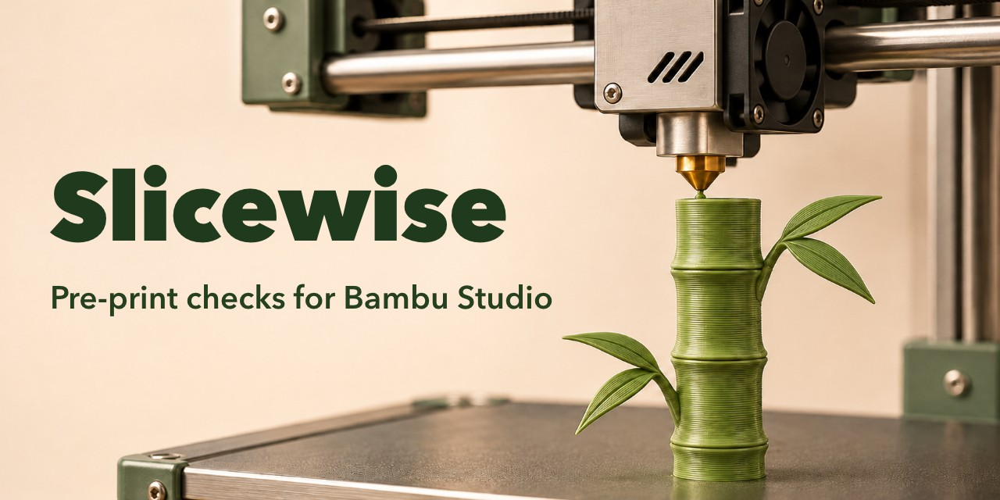

# Slicewise — pre-print decision and audit MCP server for Bambu Studio

**English** | [繁體中文](https://github.com/gjlmotea/slicewise-mcp/blob/main/README.zh-TW.md)



Slicewise lets Claude Code, Codex, Gemini CLI or any other [Model Context Protocol](https://modelcontextprotocol.io) client work with **Bambu Studio's presets, slicer and model checks**: find out whether a model will fail before you print it, decide which settings to change and why, then audit the sliced result to see which settings actually took effect.

It does **not** control printers. No MQTT, no uploads, no starting prints.

- **CLI slicing that matches the GUI.** Bambu Studio's command line ignores preset `inherits`, so slicing a stock preset from the CLI silently falls back to built-in defaults. Slicewise flattens the inheritance chain (and the per-printer G-code templates) first, then reads the sliced 3MF back and reports, override by override, whether each one was honoured.
- **Printability before slicing.** STL, 3MF and OBJ (Tinkercad exports included): out-of-bed size, **floating parts that never reach the bed**, non-manifold meshes, steep overhangs, small footprints, tall thin parts, thin features and warping risk.
- **Clearance between parts.** Minimum gaps for print-in-place mechanisms, so you know before printing whether a hinge will fuse.
- **A parameter knowledge layer.** What a setting does, its unit, a sensible range and the cost of raising or lowering it; goal-based plans (safe, fast, strong, surface, economical) and symptom-based diagnosis (warping, stringing, elephant foot, nozzle collisions…).
- **Non-destructive part edits.** Builds Bambu project 3MF files with negative parts, modifiers and support blockers/enforcers, exactly the way Bambu Studio stores them, with no geometry engine involved.
- **User presets that show up in the GUI.** Writes to the user profile folder only; system presets are never touched.

> Unofficial. Not affiliated with, endorsed or sponsored by Bambu Lab.
> Tool descriptions and messages are in English. `bambu_diagnose` and `bambu_plan_settings` also match symptoms and goals written in Chinese (e.g. 翹邊, 省時).

## Contents

- [Quick start](#quick-start)
- [Tools](#tools)
- [Why flattening matters](#why-flattening-matters)
- [Floating-part detection](#floating-part-detection)
- [Non-destructive part edits](#non-destructive-part-edits)
- [Configuration](#configuration)
- [Boundaries](#boundaries)
- [Support matrix](#support-matrix)
- [Development](#development)
- [License and trademarks](#license-and-trademarks)

## Quick start

Requires Node.js 22 or newer. Slicing needs Bambu Studio installed locally; the parameter and model tools work without it.

Claude Code:

```bash
claude mcp add slicewise \
  -e BAMBU_MODEL_DIR="$HOME/Desktop/bambu-work" \
  -e BAMBU_OUTPUT_DIR="$HOME/Desktop/bambu-work/out" \
  -- npx -y @gjlmotea/slicewise-mcp
```

Other clients (Codex, Gemini CLI, Cursor, Claude Desktop…):

```json
{
  "mcpServers": {
    "slicewise": {
      "command": "npx",
      "args": ["-y", "@gjlmotea/slicewise-mcp"],
      "env": {
        "BAMBU_MODEL_DIR": "/Users/you/Desktop/bambu-work",
        "BAMBU_OUTPUT_DIR": "/Users/you/Desktop/bambu-work/out"
      }
    }
  }
}
```

Then ask the agent to call `bambu_get_status`: it shows the Bambu Studio data folder, whether the slicer was found, preset counts, the printer and filament currently selected in Studio, and the folders the model tools may read.

**macOS privacy note.** macOS restricts access to `~/Desktop`, `~/Documents` and `~/Downloads`. If a model tool returns `EPERM`, grant the MCP host (the actual executable, e.g. the `claude` CLI rather than the Claude desktop app) access in System Settings and restart it, or point `BAMBU_MODEL_DIR` at an unrestricted folder.

## Tools

16 tools, all prefixed `bambu_`.

| Area | Tool | What it does |
|---|---|---|
| Parameters | `bambu_plan_settings` | Before printing: state a goal (safe, fast, strong, surface, economical) and get settings grouped by the failure they prevent, adjusted for the model's geometry when one is given |
| | `bambu_optimize_print_in_place` | Creates a conservative user process preset for print-in-place parts (slow first layer, capped outer-wall speed, overhang slowdown, no auto brim unless asked) |
| | `bambu_describe_parameters` | Meaning, unit, range, cost of raising or lowering, related settings |
| | `bambu_diagnose` | After printing: from a symptom to an ordered list of fixes, one change at a time |
| | `bambu_resolve_preset` | Flattens a preset and shows which layer each value came from |
| | `bambu_compare_presets` | Differences between two flattened presets |
| | `bambu_list_presets` | Selectable presets (abstract parents and G-code template entries filtered out) |
| | `bambu_save_user_preset` | Writes a user preset that appears in Studio after a restart |
| Slicing | `bambu_slice` | Flatten, slice, report layers, time and filament (per colour for multi-colour), and audit every override |
| Models | `bambu_inspect_model` | STL, 3MF or OBJ geometry: triangles, bounds, volume, area, closed mesh, parts |
| | `bambu_check_printability` | Size, floating parts, non-manifold, overhangs, footprint, aspect ratio, thin features, warping |
| | `bambu_measure_clearance` | Minimum gap between parts of a 3MF or OBJ, with compensation advice |
| | `bambu_compose_model` | Builds a Bambu project 3MF with negative, modifier and support-control parts |
| | `bambu_inspect_project` | Reads back the objects and parts of any Bambu project 3MF |
| Search | `bambu_search_models` | Thingiverse through its official API; MakerWorld and Printables as search links only |
| Status | `bambu_get_status` | Data folder, slicer, presets, current selection, allowed folders |

## Why flattening matters

Bambu Lab's stock presets are four-level inheritance chains. The leaf declares a few dozen keys and inherits the rest:

```
0.20mm Standard @BBL X1C  <-  fdm_process_single_0.20  <-  fdm_process_single_common  <-  fdm_process_common
```

When a leaf preset is passed to the CLI with `--load-settings`, **`inherits` is not resolved**. Only the leaf's own keys apply; everything else falls back to the executable's built-in defaults, which are not Bambu Lab's stock values. Measured on an X1 Carbon 0.4 nozzle, 0.20mm Standard, Bambu PLA Basic, 20 mm cube:

| Setting | Raw preset | Flattened |
|---|---|---|
| `sparse_infill_density` | 20% (built-in default) | **15% (stock preset)** |
| `top_shell_layers` | 4 | **5** |
| `elefant_foot_compensation` | 0 | **0.15** |
| `enable_arc_fitting` | 0 | **1** |
| `brim_width` | 0 | **5** |
| Print time | 10m 11s | **8m 45s** |

This is the cause of [bambulab/BambuStudio#1704](https://github.com/bambulab/BambuStudio/issues/1704) (CLI and GUI slicing differ).

Two more traps are handled:

- **Printer G-code lives outside the preset.** Since Studio 02.07, start, filament-change, layer-change and end G-code are registered separately in `system/BBL.json` as `<preset> template <key>` entries. Following `inherits` alone ends at a generic start sequence that matches no Bambu printer. Slicewise applies the templates layer by layer; on a P2S 0.4 the resulting G-code is byte-identical to the GUI's.
- **The CLI can turn the prime tower off.** When every loaded filament preset has the same name (five slots of Generic PLA in different colours), the CLI decides they are one spool and disables the prime tower. Slicewise passes the project's own filament colours in that case. On a four-colour P2S plate, flattening alone gave 40.10 g / 2h 6m with no prime tower and generic G-code; with the templates and colours applied the result was 43.68 g / 2h 18m, matching the GUI exactly.

## Floating-part detection

A real case: a birthday-cake topper built from boxes in Tinkercad. The legs ended at z = 50 mm and the body started at z = 51 mm. Bambu Studio reports "Levitating objects cannot be printed without supports", but enabling supports is the wrong fix: the support fills the 1 mm gap and the legs snap off when it is removed. Bounding boxes and overhang angles look fine; what matters is connectivity.

`bambu_check_printability` therefore:

1. Splits the geometry into shells by shared vertices (works on STL soups too); negative parts, modifiers and support blockers/enforcers are not solid.
2. Merges shells whose surfaces touch or interpenetrate into bodies.
3. Merges bodies fully enclosed by another shell, using a per-shell ray-parity test (counting crossings over a whole body of overlapping shells gives odd + odd = even and a false "outside").
4. Reports each body that does not reach the bed: its lift, the body it should probably join (grounded bodies first) and the gap.

Gaps of 2 mm or less are flagged as a likely modelling seam: fix the model with some overlap instead of adding supports. This is a rule of thumb, not a certainty: intentional print-in-place clearances (captive balls, hinges) land in the same range, so the report asks you to confirm the design intent. Wider gaps are real overhangs that need support.

## Non-destructive part edits

Bambu Studio's negative parts, modifiers and support controls are not mesh edits. They are extra parts with a `subtype` label in the 3MF:

```xml
<part id="2" subtype="negative_part">
  <metadata key="name" value="hole"/>
</part>
```

So `bambu_compose_model` needs no boolean engine and no GUI automation. It accepts exactly five subtypes, taken from `ModelVolume::type_to_string()` in Bambu Studio's source: `normal_part`, `negative_part`, `modifier_part`, `support_blocker`, `support_enforcer`. The list is closed on purpose. Studio's reader silently treats an unknown string as a solid part, so a one-letter typo turns "cut this away" into "add this as solid" with no error. Measured on a 20 mm cube with the same body on top: no part, 20.00 mm tall; `negative_part`, 15.00 mm; `normal_part`, 25.00 mm.

## Configuration

| Variable | Default | Meaning |
|---|---|---|
| `BAMBU_MODEL_DIR` | unset | Folders the model tools may read, joined with the platform path delimiter. **Model tools refuse every path when unset** |
| `BAMBU_OUTPUT_DIR` | unset | Where sliced and composed 3MF files go (also readable). **Slicing and composing refuse to run when unset** |
| `BAMBU_STUDIO_PATH` | per platform | Bambu Studio executable |
| `BAMBU_DATA_DIR` | per platform | Bambu Studio data folder (system and user presets) |
| `BAMBU_SLICE_TIMEOUT_MS` | `300000` | Timeout for one slice |
| `THINGIVERSE_TOKEN` | unset | [Thingiverse app token](https://www.thingiverse.com/developers); without it, search returns links only |

| Platform | Data folder | Executable |
|---|---|---|
| macOS | `~/Library/Application Support/BambuStudio` | `/Applications/BambuStudio.app/Contents/MacOS/BambuStudio` |
| Windows | `%APPDATA%\BambuStudio` | `%ProgramFiles%\Bambu Studio\bambu-studio.exe` |
| Linux | `~/.config/BambuStudio` | `~/.local/bin/bambu-studio` |

## Boundaries

- **No printer control.** Physical machines are irreversible and can be dangerous, so it is deliberately out of scope. Use a printer-control MCP alongside this one if you need that.
- **Reads only allowed folders.** Paths outside `BAMBU_MODEL_DIR` (and the output folder) are refused, including `..` traversal and same-prefix neighbours (`/models-evil` does not pass a check for `/models`).
- **Writes only the user profile folder and the output folder.** System presets are never written; an existing user preset with the same name is never silently overwritten.
- **No browser automation dressed up as an API.** MakerWorld and Printables have no official public API, so they get search links, not scraped results.
- **No guessing.** `bambu_diagnose` says so when a symptom is unknown and lists the ones it knows, because a wrong guess can make things worse.
- **No destructive geometry.** Boolean results are left to the slicer; computing new meshes (merges, cuts, embossed text) belongs in Blender or OpenSCAD.
- **Clearance needs part boundaries.** `bambu_measure_clearance` reads 3MF and OBJ; an STL is one undivided soup of triangles, and the tool says so instead of returning an empty report.
- **Existing projects are read, not rewritten.** `bambu_inspect_project` reads any Bambu project 3MF; `bambu_compose_model` always writes a new file.

## Support matrix

| | Status |
|---|---|
| macOS + Bambu Studio 02.07 | Verified on real hardware, including GUI comparison and end-to-end slicing |
| Stock presets | Tested with X1C, P1S and P2S 0.4 nozzle presets |
| Windows, Linux | Default paths implemented, not yet verified on a real install |
| Multi-nozzle printers (H2D…) | Not verified; per-nozzle settings are arrays, so check them with `bambu_resolve_preset` before overriding |

Bug reports with your OS, Studio version and printer are welcome.

## Development

```bash
pnpm install
pnpm verify   # typecheck, 226 tests, build, stdio smoke test
```

The smoke test uses a fixture data folder, so it runs without Bambu Studio (including in CI). `node scripts/verify-real-slicer.mjs` runs the real slicer end to end and is deliberately not part of `verify`.

```
src/
  domain/        pure logic: preset flattening, parameter knowledge, slicing audit, model geometry, 3MF
  ports/         PresetStore, Slicer, ModelCatalog
  adapters/      Bambu Studio CLI, preset store, Thingiverse, hand-off catalogs
  application/   BambuService
  server/        tool registration and schemas
```

The ZIP reader and writer, STL and OBJ parsers and 3MF builder are hand-written; the only runtime dependencies are the MCP SDK and zod.

### Updating the key baseline

`src/domain/parameters/known-keys.ts` is generated: the 568 setting keys of a flattened Bambu Studio configuration, used to catch typos in overrides (Bambu Studio silently ignores unknown keys). Regenerate it when a Bambu Studio release adds parameters:

```bash
node scripts/verify-real-slicer.mjs   # writes a .gcode.3mf
# take the key list from Metadata/project_settings.config in that file and overwrite known-keys.ts
```

It is not every key of every printer: multi-nozzle and other models may have extra keys, so an unknown key is reported as a warning, not an error.

## License and trademarks

MIT. Bambu Lab, Bambu Studio and MakerWorld are trademarks of Bambu Lab. Thingiverse and Printables are trademarks of their respective owners. This project is not affiliated with or endorsed by any of them. It runs Bambu Studio's command-line interface as a separate process and contains no Bambu Studio (AGPL-3.0) code.
